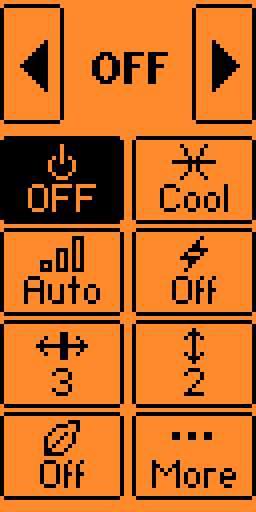
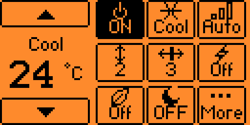
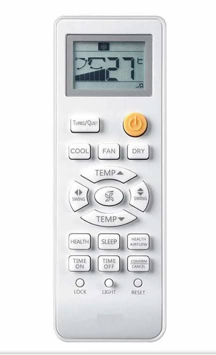

# Flipper-Zero-Haier-AC
Flipper Zero dynamic remote for Haier AC.

TESTED IN MOMENTUM DEV

---- VERTICAL LAYOUT

---- HORIZONTAL LAYOUT

---- REMOTE TYPE

A custom infrared remote-control application for the **Haier AS35RBAHRA-3 air conditioner**, designed for Flipper Zero running Momentum firmware.

Developed by **Marcopiiit**.

## Features

- **Power:** Turn the air conditioner on or off.
- **Operating modes:** Auto, Cool, Heat, Dry, and Fan.
- **Temperature:** Adjustable from 16°C to 30°C.
- **Fan speed:** Auto, Low, Medium, and High, subject to operating-mode restrictions.
- **Vertical swing:** Selectable positions and Auto.
- **Health:** Toggle the Health function.
- **Sleep:** Toggle Sleep mode when supported by the selected operating mode.
- **Turbo / Quiet:** Select Turbo or Quiet when supported.
- **Self Clean:** Send a dedicated Self Clean command in supported modes.
- **Full-state transmission:** Build and transmit a complete 22-byte infrared frame.
- **Manual transmission:** Infrared signals are sent only when the OK button is pressed.

## Supported Hardware

| Component | Model |
|---|---|
| Device | Flipper Zero |
| Firmware | Momentum |
| Air conditioner | Haier AS35RBAHRA-3 |
| Original remote | YR-HE2 |
| Infrared carrier | 38 kHz |
| Frame length | 176 bits (22 bytes) |

## Controls

| Button | Action |
|---|---|
| Up / Down | Navigate the menu |
| Left / Right | Change the selected setting |
| OK | Transmit the current state |
| Back | Exit the application |

Selecting **Self Clean** and pressing OK sends the dedicated Self Clean command when the current mode allows it.

Changing a setting does not immediately transmit an infrared signal. Press OK to send the updated state.

## Operating Restrictions

The application implements the following restrictions based on the observed behavior of the original remote:

- Vertical swing position 1 is available only in Heat mode.
- Sleep is disabled in Fan mode.
- Turbo and Quiet are available only in Cool and Heat modes.
- Turbo and Quiet force the fan setting to Auto.
- Changing the fan setting disables Turbo or Quiet.
- Auto fan speed is not available in Fan mode.
- Self is available in Cool, Dry, and Fan modes.

Actual compatibility may depend on the air conditioner firmware and the accuracy of the captured infrared protocol.

## Infrared Protocol

The application generates a raw infrared signal using a 38 kHz carrier frequency and a 33% duty cycle.

The frame consists of 22 bytes transmitted most-significant bit first.

The implementation includes two additive checksum fields:

- **Byte 13:** Sum of bytes 0–12, truncated to 8 bits.
- **Byte 21:** Sum of bytes 14–20, truncated to 8 bits.

The frame layout and command values are based on infrared captures from the original remote. Some command fields and operating combinations still require further validation against additional captures.

## Build

Install Python and uFBT, following the official Flipper Zero application development documentation.

Place the source file and application manifest in your project directory.

Example project structure:

    haier_ac/
    ├── application.fam
    └── haier_ac.c

Compile the application with:

    ufbt

If compilation succeeds, uFBT generates the application package (`.fap`) in its build output directory.

To install the application on a connected Flipper Zero, use:

    ufbt launch

Ensure that `application.fam` uses the correct entry point and dependencies for your source file and firmware environment.

## Installation

1. Compile the application using uFBT.
2. Locate the generated `.fap` file.
3. Copy it to the Flipper Zero SD card under:

       /ext/apps/Infrared/

4. Open **Apps → Infrared** on your Flipper Zero.
5. Launch **Haier AC Remote**.

The exact menu location may vary depending on the firmware version.

## Known Limitations

The following areas require additional validation against original remote captures and real-world testing:

- Power, mode, and temperature command codes.
- Turbo and Quiet behavior with different fan settings.
- Fan speed encoding across all operating modes.
- Horizontal swing control.
- Timer functions.
- Additional remote-control buttons not yet implemented.
- Checksum and state-field behavior across a wider set of captures.

The current implementation does not provide a complete replacement for every function of the original YR-HE2 remote.

## Safety and Testing

Test the application with the air conditioner in sight and verify each command individually. Check the selected mode, temperature, fan speed, and swing position before transmitting.

Infrared transmission requires line of sight to the air conditioner receiver in typical installations.

## Author

**Marcopiiit**

